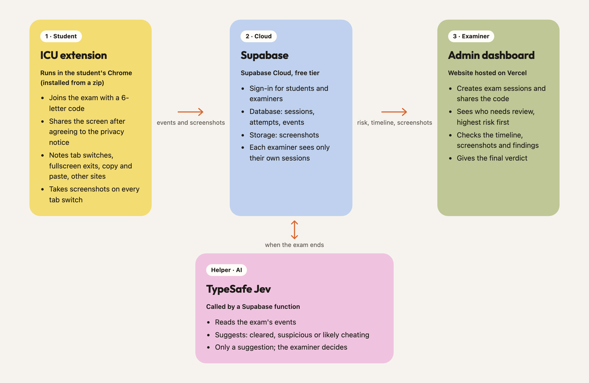

  

<h1 align="center">ICU: I Caught You</h1>

<b>It catches the tab switch. A person makes the call.</b> 
Fair, privacy-aware monitoring for online certification exams.

  <a href="https://icu-dashboard-ten.vercel.app/"><b>Sign up or sign in</b></a> ·
  <a href="https://icu-dashboard-ten.vercel.app/downloads/ICU-extension.zip"><b>Download the extension (zip)</b></a>

## Overview

**ICU** stands for **"I Caught You"**. It's a university project for exams taken online on someone else's website, such as Google Forms, Cisco NetAcad or Coursera, where the examiner can't see what students do in their browser.

ICU has two parts:

- A **Chrome extension** that students turn on before the exam.
- An **admin dashboard** where the examiner reviews the evidence afterwards.

ICU warns students and flags what it sees, but it never ends an exam or decides that someone cheated. A person always makes the final call.

## What it does

- **Watches the exam tab:** records when the student leaves the exam tab, opens other sites, copies or pastes, or leaves fullscreen.
- **Takes screenshots:** of the shared screen on every tab switch and at intervals, so the examiner sees what was on screen.
- **Warns the student at once:** each rule break shows a warning, up to the warning limit the examiner set.
- **Notices tampering:** if the extension is turned off or the exam tab closes, the silence shows up as "monitoring lost".
- **Scores the risk:** every candidate gets a Low, Medium or High risk level with a points breakdown.
- **Gives an AI suggestion:** when the exam ends, an AI reads the activity timeline and suggests a result with a confidence level.
- **Supports the verdict:** the examiner sees the findings, the timeline and the screenshots, then records Cleared, Suspicious or Cheating confirmed.

## Why use ICU

- **Works with the exam site you already use.** There's no exam to rebuild; ICU watches whichever site the examiner names.
- **No webcam.** It records browser activity and the shared screen only, which is less intrusive than camera proctoring.
- **Evidence, not accusations.** Risk scores and AI suggestions only help; the examiner decides.
- **Privacy built in.** Students read and accept a notice based on the Philippine Data Privacy Act (RA 10173) first. Data is deleted after 30 days, or earlier by the examiner, and each examiner sees only their own sessions.
- **Free to run.** It fits on the free tiers of Supabase and Vercel.

## How it works

1. The **examiner** creates an exam session on the dashboard and gives students its 6-character code.
2. The **student** enters the code in the extension, agrees to the privacy notice and shares their entire screen. ICU switches to the exam tab and makes it fullscreen.
3. During the exam, the **extension** sends events and screenshots to **Supabase**.
4. When the exam ends, Supabase asks the **AI** (TypeSafe Jev) for a suggestion and saves it.
5. The **examiner** opens the candidate on the dashboard, reviews the evidence and saves a verdict.

### Architecture

  

## Tech stack

| Part | Built with |
| --- | --- |
| Chrome extension | Manifest V3, [WXT](https://wxt.dev) 0.21, React 18, TypeScript 5.9, input-otp |
| Admin dashboard | React 18, Vite 8, React Router 7, Base UI, Sonner; hosted on [Vercel](https://vercel.com) |
| Backend | [Supabase](https://supabase.com): Auth, Postgres with row-level security, Storage, Edge Functions (Deno), pg_cron and pg_net |
| AI suggestion | TypeSafe Jev, called from the `ai-analyze` Edge Function (the key stays on the server) |
| Shared logic | `packages/core`: event catalogue, URL matching, monitoring gaps, risk scoring, warnings |
| Design | ICU design system (`packages/ui-tokens/icu.css`), Satoshi font, hand-drawn SVG icons |
| Testing | Vitest (unit and integration), Playwright (browser tests with the real extension), axe-core (accessibility) |

## Links and download

| | |
| --- | --- |
| **Sign up or sign in** | https://icu-dashboard-ten.vercel.app/ (choose **I'm a student** or **I'm an admin**; admins then reach the dashboard) |
| **Extension download** | [ICU-extension.zip](https://icu-dashboard-ten.vercel.app/downloads/ICU-extension.zip) (also in this repo at `dashboard/public/downloads/ICU-extension.zip`) |

## Getting started

### For examiners

1. Open the [sign-up page](https://icu-dashboard-ten.vercel.app/) and choose **I'm an admin**.
2. Choose **Create an admin account**, enter your name, email and password, and sign in.
3. Go to **Sessions → Create session**. Fill in the name, the exam platform (a name like `netacad` or a site like `docs.google.com/forms`), a short note about the exam, the date and time, and the warning limit.
4. Give your students the session's 6-character **code**.
5. After the exam, open **Needs review**. Pick a candidate, check the findings, timeline, screenshots and AI suggestion, then choose a verdict and **Save verdict**.

### For students

1. [Download the ICU extension](https://icu-dashboard-ten.vercel.app/downloads/ICU-extension.zip) and unzip it.
2. In Chrome, open `chrome://extensions`, turn on **Developer mode** (top right), click **Load unpacked** and choose the unzipped folder.
3. Pin ICU to the toolbar, click its icon, choose **I'm a student**, and sign up or sign in.
4. Open your exam page. In ICU, enter the code from your examiner, click **Find exam**, then **Continue**.
5. Read the privacy notice, click **I agree & share screen**, and choose your **entire screen**. On a Mac, the first time, allow Chrome under System Settings → Privacy & Security → Screen Recording.
6. Take your exam. When you finish, click **End exam** in ICU.

## Known limitations

- The extension can't see phones, other people, other devices, other browsers or incognito windows. There's no webcam, by design.
- Tampering is **detected** (as monitoring gaps), not prevented. A determined student controls their own machine, so the evidence supports a human decision and doesn't prove cheating.
- Screenshots show the whole screen the student shared. If the student stops sharing, it is recorded as a warning and screenshots fall back to the visible browser tab until they share again.
- Anyone can sign up as an admin, but an admin sees only the sessions they created.
- The extension uses permission on all websites (needed for screenshots), so it's meant to be loaded unpacked, not published to the Chrome Web Store.
- Supabase's "leaked password protection" isn't enabled. It may require a paid plan (not verified).

More detail is in [docs/IDEA.md § Known limitations](docs/IDEA.md#known-limitations).

## Project documents

| | |
| --- | --- |
| Why and what | [docs/IDEA.md](docs/IDEA.md) · research: [docs/RESEARCH.md](docs/RESEARCH.md) |
| Requirements (R1–R35) | [docs/PRD.md](docs/PRD.md) |
| Design | [docs/SDD.md](docs/SDD.md) (system) · [docs/DSD.md](docs/DSD.md) (UI) |
| Tests (T1–T65) | [docs/QAD.md](docs/QAD.md) |
| Milestones and status | [docs/BUILD.md](docs/BUILD.md) |
| Handoff for UI/UX work | [docs/UI-HANDOFF.md](docs/UI-HANDOFF.md) · backend connection: [docs/BACKEND-HANDOFF.md](docs/BACKEND-HANDOFF.md) |

## Licences

All production dependencies are MIT or 0BSD (checked 2026-11-14; sonner, @base-ui/react and input-otp added 2026-11-15, all MIT). The icons are hand-drawn in `packages/ui-tokens/icons.tsx`, and the logo and student avatars were supplied by the project owner.

**Satoshi** (`packages/ui-tokens/fonts`) is under the ITF Free Font License (`fonts/LICENSE-Satoshi-FFL.txt`). It may be embedded in this app and extension, but the font files must not be redistributed on their own, so keep this repository private (or remove the Satoshi files and fetch them from fontshare.com) if you publish it.
