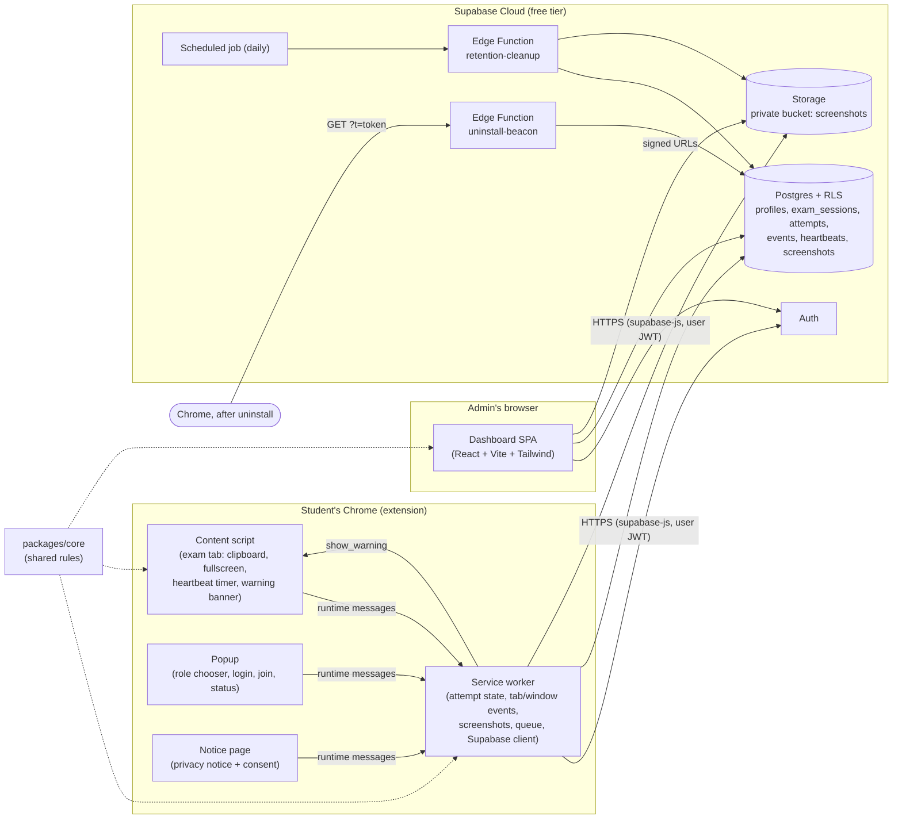

# online-certification-monitoring — System design

How the product is built to satisfy [PRD.md](PRD.md), consistent with [DSD.md](DSD.md).
Updated: 2026-11-14
Status: draft for user review. Items marked **(M1 prototype)** are decided by the first milestone in [BUILD.md](BUILD.md).

## Architecture overview

There are three deployable parts and one shared library.
- **Chrome extension** (Manifest V3, built with WXT): runs on the student's machine and observes browser activity during an active attempt. Its **service worker** is the only part that talks to Supabase. The popup, the privacy-notice page and the content script all send it messages.
- **Admin dashboard:** a static React single-page app that admins use to create sessions and review attempts.
- **Supabase Cloud** (free tier, no local or Docker setup, [IDEA.md Q19](IDEA.md#decisions-interview-q1q25)): Auth, Postgres with row-level security, a private Storage bucket for screenshots, and two Edge Functions.
- **`packages/core`:** the shared TypeScript library for event types, risk scoring, gap detection, URL matching, screenshot coalescing and the warning policy. The extension, the dashboard and the tests all import it, so rules have one home.



### Repository layout

An npm-workspaces monorepo. It refines [IDEA.md Q14](IDEA.md#decisions-interview-q1q25) by adding the shared `packages/`.

```text
extension/                 WXT app (MV3)
  entrypoints/background.ts    service worker
  entrypoints/content.ts       content script (all frames, dormant unless exam tab)
  entrypoints/popup/           React popup
  entrypoints/notice/          React privacy-notice page
  lib/                         supabase client + chrome.storage adapter, queue, capture scheduler, attempt state
dashboard/                 Vite + React SPA
packages/core/             shared TS: event catalogue, scoring, gaps, URL matching, coalescer, warning policy, session-code alphabet
packages/ui-tokens/        CSS variables + Tailwind preset from DSD.md
supabase/migrations/       SQL migrations (schema, RLS, RPCs, storage policies)
supabase/functions/        uninstall-beacon/, retention-cleanup/
supabase/tests/            RLS integration tests (Vitest + supabase-js, against the test project)
e2e/                       Playwright tests that load the unpacked extension
README.md
```

## Components and responsibilities

| Component | Owns | Must never |
| --- | --- | --- |
| **Service worker** (`extension/entrypoints/background.ts`) | The single Supabase client and the auth session (in a `chrome.storage.local` adapter set to `TRUSTED_CONTEXTS`, [F8](RESEARCH.md#findings), [F13](RESEARCH.md#findings)). Attempt state machine (`idle → joined → active → ended`) persisted in `chrome.storage.local`. Exam-tab binding and URL matching. Tab and window focus events (`chrome.tabs`, `chrome.windows`). Visited-URL capture. Warning policy and counter. Screenshot capture, resize and upload. Heartbeat sending and the backup alarm. The offline queue. The uninstall URL | Collect anything while not `active` (R8, R26). Store clipboard content, query strings or page text (R26). Hold a service-role key (R25). Rely on in-memory state surviving, since the worker may stop after 30 s idle ([F9](RESEARCH.md#findings)) |
| **Content script** (`content.ts`) | On load it asks the worker whether its tab is the exam tab; otherwise it stays dormant with no listeners. In the exam tab, in all frames: `copy`/`cut`/`paste`/`contextmenu` listeners (type only), and fullscreen-change detection if DOM fullscreen is chosen (OQ1). In the top frame only: the 15 s heartbeat timer and the shadow-DOM warning banner | Read the clipboard, the form values or the DOM text (R12, R26). Talk to Supabase or hold tokens. Block or cancel any page event (`preventDefault`) |
| **Popup** (`popup/`) | The role chooser, sign-up and login forms, wrong-role message, code entry, session summary, monitoring status and End exam button. Each action is a message to the worker | Own a Supabase client (a second client would compete over token refresh) |
| **Notice page** (`notice/`) | Renders the privacy notice (versioned, `NOTICE_VERSION` in `packages/core`), the two consent checkboxes and Start. Start sends a message to the worker | Enable Start before both boxes are ticked (R7) |
| **Dashboard** (`dashboard/`) | Role chooser, admin sign-up and login, wrong-role message, sessions list and create form, session detail, candidate review (timeline, gaps, filters, breakdown, gallery, verdict, delete). It computes risk and gaps with `packages/core` | Show data from another admin's sessions; it never relies only on UI checks, because RLS enforces this (R25). Hold a service-role key |
| **Postgres + RLS** (`supabase/migrations`) | Schema, constraints, triggers that set server timestamps, RLS policies, and the RPC functions (below) | Let students update or delete monitoring data. Accept client-supplied `received_at` |
| **Storage bucket `screenshots`** | Private JPEG objects at `{session_id}/{attempt_id}/{screenshot_id}.jpg` | Be public. Serve images except through signed URLs to the session's admin (R21) |
| **Edge Function `uninstall-beacon`** | Accepts `GET /uninstall-beacon?t=<token>`, calls `record_uninstall(token)` with the service role, and returns a short HTML page: "The monitoring extension was removed. Your examiner will see this." | Need a user JWT (it's opened by Chrome with no session). Reveal whether a token was valid. Accept personal data |
| **Edge Function `retention-cleanup`** | Run once a day by the scheduled job. Finds attempts with `ended_at < now() − 30 days` and `data_deleted_at is null`, removes their Storage objects, deletes their events, heartbeats and screenshot rows, and sets `data_deleted_at` (R24) | Run without the shared secret header. Delete attempts that are still within retention |
| **`packages/core`** | Pure functions and constants (listed in [Interfaces](#interfaces-and-apis)). No I/O | Import Chrome or Supabase APIs. That keeps it unit-testable |
| **`packages/ui-tokens`** | The CSS custom properties and Tailwind preset defined in [DSD.md § Tokens](DSD.md#tokens) | Contain component logic |

## Data model

All timestamps are `timestamptz` in UTC. IDs are `uuid` unless noted. All tables have RLS enabled.

### Entities

**`profiles`**: one per Auth user, created by an `auth.users` insert trigger from sign-up metadata (R2).

| Field | Type | Notes |
| --- | --- | --- |
| `id` | uuid PK, FK → `auth.users.id` on delete cascade | |
| `role` | text, `check (role in ('student','admin'))`, not null | From `raw_user_meta_data.role`; immutable (no update policy) |
| `full_name` | text, not null, 1–120 chars | |
| `email` | text, not null | Copied from Auth for display |
| `created_at` | timestamptz default now() | |

**`exam_sessions`**: created by an admin (R4).

| Field | Type | Notes |
| --- | --- | --- |
| `id` | uuid PK default `gen_random_uuid()` | |
| `admin_id` | uuid FK → `profiles.id`, not null | Must have the role `admin` (checked by an insert policy) |
| `name` | text, 1–120 chars | |
| `code` | text unique, `check (code ~ '^[ABCDEFGHJKLMNPQRSTUVWXYZ23456789]{6}$')` | Generated by `create_session` |
| `url_patterns` | text[], length 1–10 | Glob patterns, see `matchExamUrl` |
| `starts_at`, `ends_at` | timestamptz, `check (ends_at > starts_at)` | |
| `warning_limit` | int default 3, `check (between 1 and 10)` | |
| `threshold_medium`, `threshold_high` | int default 10 / 25, `check (0 < threshold_medium < threshold_high)` | |
| `created_at` | timestamptz default now() | |

**`attempts`**: one per student per session (R6–R8, R22, R23).

| Field | Type | Notes |
| --- | --- | --- |
| `id` | uuid PK | |
| `session_id` | uuid FK → `exam_sessions` on delete cascade | `unique (session_id, student_id)` |
| `student_id` | uuid FK → `profiles` | Must have the role `student` |
| `status` | text `check in ('joined','active','ended')` | |
| `consent_at` | timestamptz null | Set by `start_attempt` |
| `consent_version` | text null | e.g. `2026-11-14.1` |
| `age_confirmed` | boolean default false | Must be true to start (R7, Q25) |
| `started_at`, `ended_at` | timestamptz null | Server time |
| `end_reason` | text null `check in ('student','time_window')` | |
| `uninstall_token` | uuid null, unique | Random per attempt; set to null when used or when the attempt ends (R15) |
| `verdict` | text null `check in ('cleared','suspicious','cheating_confirmed')` | |
| `verdict_note` | text null, ≤ 1,000 chars | |
| `verdict_by` | uuid null FK → `profiles` | |
| `verdict_at` | timestamptz null | |
| `data_deleted_at` | timestamptz null | Set by delete or retention (R23, R24) |
| `created_at` | timestamptz default now() | |

**`events`**: append-only monitoring events (R9–R17, R30).

| Field | Type | Notes |
| --- | --- | --- |
| `id` | uuid PK | **Generated by the client**, so a retried upload can't create a duplicate (see the queue flush in F3) |
| `attempt_id` | uuid FK → `attempts` on delete cascade | Index `(attempt_id, occurred_at)` |
| `type` | text `check (type in (…catalogue…))` | See [Event catalogue](#event-catalogue) |
| `occurred_at` | timestamptz | Client time when the event happened (kept through the offline queue) |
| `received_at` | timestamptz | **Set by a trigger to `now()`**; client values are overwritten |
| `details` | jsonb default `'{}'`, ≤ 2 KB | Per-type shape, see the catalogue |
| `screenshot_id` | uuid null FK → `screenshots` on delete set null | |

**`heartbeats`**: liveness signals (R14).

| Field | Type | Notes |
| --- | --- | --- |
| `id` | bigint identity PK | |
| `attempt_id` | uuid FK → `attempts` on delete cascade | Index `(attempt_id, received_at)` |
| `received_at` | timestamptz | **Set by a trigger to `now()`**; this is the only time used for gaps |
| `source` | text `check in ('content','alarm')` | For diagnostics |

**`screenshots`** (R16, R21).

| Field | Type | Notes |
| --- | --- | --- |
| `id` | uuid PK | Generated by the client |
| `attempt_id` | uuid FK → `attempts` on delete cascade | |
| `storage_path` | text, unique | `{session_id}/{attempt_id}/{id}.jpg` |
| `captured_at` | timestamptz | Client time |
| `reason` | text `check in ('interval','violation')` | |
| `bytes` | int | Used to check the R29 budget |
| `received_at` | timestamptz | Trigger-set |

**`join_failures`**: supports the code-guessing rate limit in [Security](#security) (R6). Only `join_session` can access it; there are no client policies.

| Field | Type | Notes |
| --- | --- | --- |
| `id` | bigint identity PK | |
| `user_id` | uuid FK → `profiles` | Index `(user_id, created_at)` |
| `created_at` | timestamptz default now() | Rows older than 1 day are deleted by `retention-cleanup` |

### Ownership and relationships

```text
profiles(admin) 1─* exam_sessions 1─* attempts *─1 profiles(student)
attempts 1─* events ; attempts 1─* heartbeats ; attempts 1─* screenshots ; screenshots 1─* events
```

The admin owns the session and everything under it. The student owns their profile, and can create, but not change, monitoring rows for their own active attempt.

### Event catalogue

The type list and weights live in `packages/core/src/events.ts`. The database check constraint is generated from the same list by a script, `npm run gen:sql-events`.

| Type | Source | `details` | Weight | Warns (R17) | R# |
| --- | --- | --- | --- | --- | --- |
| `exam_tab_hidden` | SW `tabs.onActivated` (exam tab deactivated in its window) | `{}` | 2 | yes | R10 |
| `exam_tab_visible` | SW | `{ away_ms }` | 0 | no | R10 |
| `window_blur` | SW `windows.onFocusChanged` → `WINDOW_ID_NONE` or a non-exam window | `{}` | 2 | yes | R10 |
| `window_focus` | SW | `{ away_ms }` | 0 | no | R10 |
| `navigated_off_exam` | SW `tabs.onUpdated` (exam tab URL no longer matches) | `{ host, path }` | 3 | yes | R9 |
| `tab_opened` | SW `tabs.onCreated` / `windows.onCreated` | `{}` | 1 | no | R11 |
| `url_visited` | SW `tabs.onUpdated` (`changeInfo.url`, non-exam URL) | `{ host, path }` | 0 | no | R11 |
| `copy` / `cut` / `context_menu` | Content script | `{ frame: 'top'\|'sub' }` | 1 each | no | R12 |
| `paste` | Content script | `{ frame }` | 3 | yes | R12 |
| `fullscreen_enter` | SW or content script (OQ1) | `{}` | 0 | no | R13 |
| `fullscreen_exit` | SW or content script (OQ1) | `{}` | 2 | yes | R13 |
| `exam_page_not_detected` | SW, 120 s after Start with no bound tab | `{}` | 8 | no | R9 |
| `warning_shown` | SW | `{ n, limit, reason_type }` | 0 | — | R17 |
| `warning_limit_reached` | SW, once | `{ limit }` | 0 (forces High) | — | R17, R18 |
| `screenshot_failed` | SW | `{ error }` | 0 | no | R16 |
| `extension_uninstalled` | `record_uninstall` (server) | `{}` | 8 | no | R15 |
| `queue_overflow` | SW | `{ dropped_events, dropped_screenshots }` | 0 | no | R30 |

### Risk scoring

`scoreAttempt(events, gaps, session)` in `packages/core` (R18):
- `score = Σ weight(event.type) + 8 × gaps.length`
- `level = 'high'` if any `warning_limit_reached`, or if `score ≥ session.threshold_high`; otherwise `'medium'` if `score ≥ session.threshold_medium`; otherwise `'low'`.
- It also returns a breakdown of `{ type, count, points }[]` for R20.

The weights are fixed in code (Q13: no per-event weight editing). Only the thresholds are per session.

## Interfaces and APIs

### Database RPCs

These are Postgres functions called with `supabase.rpc`, all `security definer` with an empty `search_path` and fully qualified names (R25). The row-level-security helper functions (`is_session_admin`, `can_write_attempt`, etc.) live in a `private` schema that the Data API doesn't expose, so they aren't callable as endpoints (migration 002, decision D5). Each checks `auth.uid()` and the caller's role first and raises a coded error (`OCM_*`) on failure.

| Function | Caller | Input | Output | Errors | R# |
| --- | --- | --- | --- | --- | --- |
| `create_session` | admin | `{ name, url_patterns[], starts_at, ends_at, warning_limit?, threshold_medium?, threshold_high? }` | `{ id, code }` | `OCM_NOT_ADMIN`, `OCM_INVALID_INPUT` | R4 |
| `join_session` | student | `{ code }` | `{ attempt_id, status, session: { id, name, admin_name, admin_email, starts_at, ends_at, url_patterns, warning_limit } }`; creates the attempt if it doesn't exist. An unknown code returns `{ error: 'OCM_CODE_NOT_FOUND' }` as a result (not an exception), so the failure recorded for the rate limit isn't rolled back (D7) | `OCM_NOT_STUDENT`, `OCM_RATE_LIMITED`, `OCM_SESSION_ENDED` | R6 |
| `start_attempt` | student | `{ attempt_id, consent_version, age_confirmed }` | `{ started_at, ends_at, uninstall_token, server_now }`. The extension uses `server_now` to correct its clock, and event times must fall within the attempt window ±2 min. Idempotent: starting an active attempt again returns the same values. It also closes the caller's attempts whose session window has passed | `OCM_NOT_OWNER`, `OCM_NOT_OPEN_YET`, `OCM_SESSION_ENDED`, `OCM_CONSENT_REQUIRED`, `OCM_ALREADY_ACTIVE` (another attempt is active) | R7, R8 |
| `end_attempt` | student | `{ attempt_id, reason: 'student'\|'time_window' }` | `{ ended_at }`; clears `uninstall_token` | `OCM_NOT_OWNER` | R8 |
| `set_verdict` | admin | `{ attempt_id, verdict, note? }` | `{ verdict_at }` | `OCM_NOT_SESSION_ADMIN`, `OCM_INVALID_INPUT` | R22 |
| `delete_attempt_rows` | admin | `{ attempt_id }` | `{ deleted_events, deleted_heartbeats, deleted_screenshots }`; sets `data_deleted_at` | `OCM_NOT_SESSION_ADMIN` | R23 |
| `record_uninstall` | service role only (Edge Function) | `{ token }` | void; inserts `extension_uninstalled` if the token matches an active attempt, then nulls the token | — (always silent) | R15 |

### Direct table access under RLS (R25)

| Table | Student | Admin |
| --- | --- | --- |
| `profiles` | select own; no update | select own, plus the profiles of students with attempts in own sessions |
| `exam_sessions` | **none** (only through `join_session`) | select own; insert through `create_session`; update own (name, window, limits, thresholds) |
| `attempts` | select own (verdict columns are excluded by a view, `my_attempts`) | select for own sessions; changes only through RPCs |
| `events` | insert when `attempt.student_id = auth.uid()` and `attempt.started_at is not null` and (`attempt.status = 'active'` or `now() < attempt.ended_at + interval '1 hour'`, the R30 grace period) and `occurred_at` is within `[started_at, coalesce(ended_at, session.ends_at)]`. No select, update or delete | select for own sessions |
| `heartbeats` | insert only when `attempt.status = 'active'` and `now() ≤ session.ends_at`. No select | select for own sessions |
| `screenshots` | insert on the same rule as events. No select | select for own sessions |
| `storage.objects` (bucket `screenshots`) | insert when path segment 2 is an attempt they own and that is uploadable (same rule as events) | select and delete when path segment 1 is a session they own |

### Extension internal messages

Typed in `packages/core/src/messages.ts`. Every message goes through `chrome.runtime.sendMessage`. The worker answers `{ ok: true, data } | { ok: false, code, message }`.

| Message | From → to | Payload | Response |
| --- | --- | --- | --- |
| `auth.signUp` / `auth.signIn` / `auth.signOut` | popup → SW | `{ email, password, full_name?, role? }` | `{ role, full_name }` |
| `auth.state` | popup → SW | — | `{ signedIn, role?, full_name? }` |
| `attempt.join` | popup → SW | `{ code }` | `join_session` output |
| `attempt.openNotice` | popup → SW | — | opens `notice.html` in a tab |
| `attempt.start` | notice → SW | `{ age_confirmed: true, consent_version }` | `{ started_at, ends_at }` |
| `attempt.end` | popup → SW | — | `{ ended_at }` |
| `attempt.status` | popup → SW | — | `{ state, session, warnings: { n, limit }, queue_size, last_heartbeat_at }` |
| `cs.hello` | content → SW | `{ top: boolean }` | `{ isExamTab, limit? }` |
| `cs.event` | content → SW | `{ type, occurred_at, details }` | `{ ok }` |
| `cs.heartbeat` | content → SW | — | `{ ok }` |
| `sw.showWarning` | SW → content (`tabs.sendMessage`) | `{ n, limit, reason_type, limitReached }` | — |
| `sw.promptFullscreen` | SW → content | — | — (OQ1) |
| `sw.activate` / `sw.deactivate` | SW → content | — | — (start or stop the heartbeat timer when the tab is bound or the attempt ends) |
| `attempt.reset` | popup → SW | — | clears a joined or ended attempt so another code can be entered |

### `packages/core` functions

All are pure, synchronous and unit-tested ([QAD.md](QAD.md)):
- `matchExamUrl(url: string, patterns: string[]): boolean`. Pattern syntax: `scheme://host/path`, where `*` matches any run of characters within the host or path, the scheme is `http`, `https` or `*`, and the query and fragment are ignored.
- `sanitizeUrl(url): { host, path }`. Strips the query and fragment; non-HTTP(S) URLs become `{ host: '<scheme>', path: '' }`.
- `findGaps(heartbeatTimes: Date[], start: Date, end: Date, thresholdMs = 60_000): Gap[]`. Includes the leading and trailing gaps.
- `scoreAttempt(events, gaps, session): { score, level, breakdown }`
- `createWarningPolicy({ limit, cooldownMs = 10_000 })` returns `{ onEvent(type, at): Decision }`, where Decision is `none` (not a warning type, or within the cool-down), `warn(n)`, `warn_and_limit(n)` (the first time n reaches the limit) or `limit_reminder` (a warning after the limit: the banner repeats the limit-reached message and `warning_shown` is still recorded, but no second `warning_limit_reached`).
- `decideCapture(state, at, windowMs = 3_000)` returns `capture` or `attach(shotId)`: a warning event within 3 s of the last capture shares its screenshot. `shouldCaptureInterval` skips an interval capture in that window. Captures are therefore at least 3 s apart, far below Chrome's 2 per second ([F6](RESEARCH.md#findings)). This replaced the planned 600 ms spacing rule, which became redundant.
- `generateSessionCode(random: () => number): string`
- `EVENT_TYPES`, `WEIGHTS`, `WARNING_TYPES`, `NOTICE_VERSION`

### Dashboard routes

| Route | Screen | R# |
| --- | --- | --- |
| `/` | Role chooser, then `/login` or the student install message | R1 |
| `/login`, `/signup` | Admin authentication | R2, R3 |
| `/sessions` | Sessions list and Create session dialog | R4, R5 |
| `/sessions/:id` | Session detail | R19 |
| `/sessions/:id/attempts/:attemptId` | Candidate review | R20–R23 |

## Key flows

### F1. Admin creates a session (R4, R5)
1. The admin fills in the form, and the dashboard validates it with the same rules as the database constraints.
2. The dashboard calls `rpc('create_session')`. The function generates a code, retries up to 5 times on a unique-key clash, and inserts the row.
3. The dashboard shows the code in large monospace with a Copy button.
4. Error path: a validation error shows inline. `OCM_NOT_ADMIN` signs the user out with the wrong-role message (R3).

### F2. Student joins and starts (R6–R9, R13)
1. In the popup, the student enters the code, and the popup sends `attempt.join`. The worker calls `join_session` and stores `{ attempt_id, session }` in `chrome.storage.local` with state `joined`.
2. The popup shows the session summary. Before `starts_at` it shows a countdown and Start is disabled.
3. Continue opens the notice page. The student ticks both boxes and clicks Start, which sends `attempt.start`. The worker calls `start_attempt` and then:
   - sets state `active`;
   - calls `chrome.runtime.setUninstallURL(<fn-url>?t=<token>)`;
   - creates alarms `ocm-heartbeat` (every 0.5 min), `ocm-screenshot` (every 1 min) and `ocm-end` (at `ends_at`);
   - looks for a tab matching `url_patterns` (the active tab first, then any tab) and binds it as `examTabId`;
   - starts the 120 s `exam-page-not-detected` timer, which is persisted as an alarm.
4. The fullscreen prompt depends on OQ1:
   - **Option A:** the worker calls `chrome.windows.update(examWindowId, { state: 'fullscreen' })` and watches `windows.onBoundsChanged`.
   - **Option B:** the worker sends `sw.promptFullscreen`, and the banner shows an "Enter fullscreen" button that calls `requestFullscreen()` with the click as the user gesture ([F10](RESEARCH.md#findings)).

   **Chosen: option A** (decision D6, 2026-11-14). Google Forms reloads the page between sections, and DOM fullscreen ends on every reload, which would cause false `fullscreen_exit` events. Browser-window fullscreen needs no click and survives reloads. Exits are detected with `windows.onBoundsChanged` and `windows.onFocusChanged` by comparing the window's `state`. At End, the extension restores the window to `normal`. E2E T31 passes; the real-Form check is spike 6a.
5. Error paths:
   - `OCM_NOT_OPEN_YET`: the countdown stays.
   - `OCM_ALREADY_ACTIVE`: the message "You already have an exam in progress."
   - Network failure: the message "Couldn't start. Check your connection." Nothing is collected (R8).

### F3. Monitoring loop (R9–R14, R16, R17)
- **Tab binding:** when any tab finishes loading (`tabs.onUpdated` with status `complete`) and matches the patterns, it becomes the exam tab if none is bound. If the bound exam tab is closed, the binding is cleared, and the next matching tab is bound.
- **Content script:** on load it sends `cs.hello`. Only the exam tab gets `isExamTab: true`. There, the top frame starts `setInterval(15 s)` sending `cs.heartbeat`, and every frame attaches clipboard listeners (`capture: true, passive: true`).
- **Heartbeat:**
  - The worker inserts each heartbeat row with source `content`.
  - The `ocm-heartbeat` alarm (every 30 s) sends a heartbeat with source `alarm` if the last one was more than 20 s ago **and** the exam tab still exists. This covers Chrome slowing timers in background tabs: Chrome's intensive throttling of hidden tabs can reduce `setInterval` to once a minute (known Chrome behaviour, **not verified in RESEARCH.md**, checked in M1).
  - With no exam tab, no heartbeats are sent, so closing the exam tab produces a gap (Q22).
- **Event recording:** each detected event:
  1. is given a client UUID and `occurred_at`;
  2. goes through the warning policy;
  3. if it is a warning type, triggers the coalescer, which either captures a new screenshot or attaches the current screenshot id;
  4. is appended to the queue;
  5. the queue is flushed.
- **Warnings:**
  - On `warn(n)`, the worker sends `sw.showWarning` to the exam tab, creates a `chrome.notifications` notification, and queues `warning_shown`.
  - On `warn_and_limit(n)`, it also queues `warning_limit_reached` once.
  - If the exam tab isn't the active tab (for example on `exam_tab_hidden`), the banner is still sent, so the student sees it on return, and the notification shows immediately.
- **Screenshots:**
  1. `chrome.windows.getLastFocused({ windowTypes: ['normal'] })`, then `chrome.tabs.captureVisibleTab(windowId, { format: 'jpeg', quality: 50 })`.
  2. The worker decodes the image with `createImageBitmap`, downscales it so the longest side is at most 1280 px with `OffscreenCanvas`, re-encodes it with `convertToBlob({ type: 'image/jpeg', quality: 0.5 })`, and queues the upload.
  3. On error (restricted page, no window), it queues `screenshot_failed` ([F6](RESEARCH.md#findings)).
- **Queue flush:**
  - The flush order is: upload screenshot objects, then insert the `screenshots` rows, then insert the events (so foreign keys resolve).
  - Events are batched, up to 50 per plain insert. If a retried batch fails with a duplicate-key error (`23505`), it was already partly or fully saved, so the batch is re-sent one row at a time and duplicates are skipped. `ON CONFLICT DO NOTHING` isn't used: PostgreSQL 18 also checks it against select policies, which students don't have (decision D4).
  - On failure, it retries with exponential backoff (1 s up to 5 min, with jitter).
  - The queue is persisted in `chrome.storage.local` with caps of 1,000 events and 20 screenshots. On overflow it drops the oldest screenshots first, then the oldest events of weight 0, and queues `queue_overflow` (R30).

### F4. End of attempt (R8, R15)
1. **Triggers:**
   - The student clicks End exam and sends `attempt.end`.
   - Or the `ocm-end` alarm fires at `ends_at`.
2. The worker flushes the queue and calls `end_attempt` with the matching reason (`student` or `time_window`).
3. It clears the alarms and calls `setUninstallURL('')` to clear the uninstall URL.
4. It tells the content script to go dormant, and the popup shows "Exam ended".
5. If `end_attempt` fails because the network is offline, it retries with the queue. Gap computation caps the end at `session.ends_at` anyway, so a missing `ended_at` never creates a false gap after the window.

### F5. Restart recovery (R8)
- On `runtime.onStartup` or when the worker wakes up, it reads the attempt state from `chrome.storage.local`. If the state is `active` and `now < ends_at`, it re-creates the alarms, re-binds the exam tab and flushes the queue. If the exam tab is still bound, it sends `sw.activate` anyway: after the extension is disabled and re-enabled, the tab's content script is gone, and activation re-injects it when nothing answers (found by T33, 2026-11-14).
- Content scripts in tabs that were already open re-run `cs.hello` when the page reloads. If a page loaded before the extension was re-enabled, the worker injects the content script with `chrome.scripting.executeScript` into the matching tabs.
- The downtime shows as a gap (R14).

### F6. Admin review (R18–R23)
1. **Session detail:** the dashboard fetches the session's attempts with the student profiles, plus per-attempt events and heartbeats.
2. **Computing risk:** it computes gaps with `findGaps(heartbeats.received_at, started_at, min(ended_at ?? now, session.ends_at))`, then risk with `scoreAttempt`. A view `attempt_event_counts` supplies the per-type counts, and heartbeat times are fetched only for the candidate review page. Session detail uses a lighter SQL function, `session_attempt_summaries(session_id)`, which returns counts and gap counts computed in SQL with `lag()`. **One rule, two implementations:** the SQL gap count must match `findGaps`, and [QAD T22](QAD.md#test-cases) checks this.
3. **Candidate review:** loads the events, the heartbeats, and the screenshots with signed URLs (`createSignedUrls`, expiry 3,600 s). It lazy-loads thumbnails.
4. **Verdict:** `set_verdict`.
5. **Delete:**
   1. The dashboard lists the objects under `{session_id}/{attempt_id}/` and removes them through the Storage API, in batches of 100.
   2. It calls `delete_attempt_rows`.
   3. If step 1 partly fails, it shows an error and allows a retry. Step 2 runs only after all objects are gone.

### F7. Uninstall (R15)
1. Chrome opens `<project>.functions.supabase.co/uninstall-beacon?t=<token>`.
2. The function calls `record_uninstall(token)`. It always returns the same page, whether or not the token was valid.
3. It is best effort only ([F12](RESEARCH.md#findings)). The heartbeat gap remains the main evidence.

### F8. Retention (R24)
1. A daily scheduled job at 03:00 Asia/Manila calls `retention-cleanup` with the header `x-ocm-cron-secret`.
2. For each expired attempt, the function runs the same removal as F6 step 5 using the service role.
3. It logs counts with `console.log`, which appear in the Supabase function logs.
4. **Scheduler mechanism:** `pg_cron` runs a daily job that calls the function with `pg_net`, reading the project URL and secret key from Vault. This is the pattern in the Supabase docs ([schedule-functions](https://supabase.com/docs/guides/functions/schedule-functions)). All three extensions were verified available on the free plan on 2026-11-14 (OQ3).

## Technology choices

| Area | Choice | Alternatives considered | Reason |
| --- | --- | --- | --- |
| Extension platform | Chrome MV3, `minimum_chrome_version: 120` | Firefox WebExtensions; MV2 | MV3 is required; version 120 gives 30 s alarms ([F9](RESEARCH.md#findings)); Firefox is out of scope (Q6) |
| Extension framework | WXT + TypeScript | CRXJS; plain JavaScript with no build | It generates the manifest, reloads on change and bundles the worker, content script and pages; plain JS gets messy with the queue and messaging (Q14) |
| UI | React 18 + Tailwind CSS 3 (with a `ui-tokens` preset); React Router 7 in the dashboard | Vue, Svelte; hand-written CSS; React Router 6 (has unfixed moderate advisories) | Shared between popup, notice page and dashboard; the tokens live in one place (DSD) |
| Dashboard build and hosting | Vite SPA, hosted on Vercel (static) or run locally | Next.js | No server rendering is needed; static hosting is free |
| Backend | Supabase Cloud free tier: Auth, Postgres + RLS, Storage, Edge Functions | Firebase; Node/Express + Postgres; PocketBase | The data is relational, RLS gives access control without server code, and it's within free-tier limits ([F7](RESEARCH.md#findings), [F25](RESEARCH.md#findings)); no Docker (Q19) |
| Auth persistence in the extension | supabase-js with a `chrome.storage.local` storage adapter, used only by the worker | One client per extension page | Avoids competing token refreshes; there's no Web Storage in workers ([F8](RESEARCH.md#findings)) |
| Liveness | Push heartbeat every 15 s plus a 30 s alarm, with server-side timestamps | Supabase Realtime Presence; alarm only | Leaves a saved record that can be reviewed after the exam; Presence isn't saved (Q22) |
| Focus detection | Worker `chrome.tabs` and `chrome.windows` events | Content-script `blur` and `visibilitychange` | Not fooled by in-page iframes taking focus, and works when the content script is throttled (inference; checked in M1, A5) |
| Screenshot pipeline | `captureVisibleTab` JPEG, downscaled with `OffscreenCanvas` in the worker | A full-size PNG; an offscreen document | Stays within the 2-per-second limit and the 10 MB per hour budget ([F6](RESEARCH.md#findings), R29); no offscreen document is needed now that the webcam is gone (Q21) |
| Monorepo | npm workspaces | pnpm, Turborepo | No extra tooling to install |
| Unit and integration tests | Vitest | Jest | Native to Vite and TypeScript |
| End-to-end tests | Playwright with a persistent Chromium context loading the unpacked extension | Puppeteer | Playwright documents loading extensions in Chromium; it works with axe (`@axe-core/playwright`) for R28 |

## Security

| Threat | Mitigation | R# |
| --- | --- | --- |
| A student reads other students' data or sessions | RLS: students can't select `exam_sessions`, other attempts or any monitoring rows; sessions are reached only through `join_session(code)` | R25 |
| A student deletes or edits their own evidence | No update or delete policies for students on monitoring tables or Storage | R25 |
| A student forges, suppresses or delays events | Can't be prevented, since the client is under their control ([RESEARCH § Risks](RESEARCH.md#risks)). Mitigated by server receive times, heartbeat gaps, append-only storage, and human review. Stated in the README and the IDEA limitations | R14, R22 |
| A student fakes heartbeats while the extension is off | Possible for a skilled attacker with their JWT. Accepted for v1 and documented. Screenshots and events would still be missing | R14 |
| A self-registered admin | Can see only sessions they created ([IDEA.md limitations](IDEA.md#known-limitations)) | R2, R25 |
| Session-code guessing | 32-character alphabet, 6 characters, about 1.07 × 10⁹ codes. A code only reveals the session name, the admin's name and email, and the window. `join_session` rate limit: at most 10 failed attempts per user per 10 minutes (stored in a `join_failures` table) | R6 |
| Token theft from the extension | Tokens are stored in `chrome.storage.local` restricted to `TRUSTED_CONTEXTS`, so content scripts can't read them ([F13](RESEARCH.md#findings)). Content scripts never receive tokens | R25 |
| Service-role key leaking | It exists only in Edge Function secrets. A CI check greps the built bundles for `service_role` and `sb_secret_` (QAD) | R25 |
| Uninstall-token abuse | It's random and single-use, only inserts one weight-8 event for its own active attempt, reveals nothing in the response, and carries no personal data ([F12](RESEARCH.md#findings)) | R15 |
| Cross-site scripting (XSS) on the dashboard | React escaping. URLs from events are shown as text, never as clickable links. Strict CSP on Vercel (`default-src 'self'; img-src 'self' https://*.supabase.co data:; connect-src 'self' https://*.supabase.co`) | R20 |
| Exam-page interference | The banner sits in a closed shadow root. The content script never calls `preventDefault`, and never reads or modifies the page | R12, R17 |
| Over-broad permissions | Permissions: `tabs`, `alarms`, `storage`, `notifications`, `scripting` (the `chrome.windows` API needs no permission), added milestone by milestone as features need them, plus `host_permissions: ["<all_urls>"]` (needed for capture in any focused tab, [F6](RESEARCH.md#findings)). Documented as unsuitable for the Chrome Web Store without review ([IDEA.md limitations](IDEA.md#known-limitations)) | R16, R27 |
| Extension CSP | The MV3 default. No remote code, and no `wasm-unsafe-eval` is needed now that MediaPipe is removed ([F3](RESEARCH.md#findings)) | R27 |

## Privacy

Legal basis: consent under RA 10173, following the NPC education-sector advisory ([F23](RESEARCH.md#findings)). The notice is versioned by `NOTICE_VERSION`, and every attempt records which version was accepted (R7).

| Data item | Purpose | Where | Who sees it | Retention | R# |
| --- | --- | --- | --- | --- | --- |
| Name, email, role | Identify the candidate and admin | `profiles`, Auth | The user; the admin of sessions the student joined | Until the account is deleted (manual, via the admin or project owner; out of scope for v1 UI) | R2 |
| Consent record | Prove informed consent | `attempts` | The session admin | With the attempt | R7 |
| Monitoring events (types in the catalogue), with host and path for URLs | Evidence for review | `events` | The session admin | 30 days after the attempt ends | R9–R17, R24 |
| Heartbeat times | Detecting monitoring gaps | `heartbeats` | The session admin | 30 days | R14, R24 |
| Screenshots of the focused browser tab | Visual evidence | Storage | The session admin, through signed URLs | 30 days, or earlier on admin delete | R16, R21, R23, R24 |
| Verdict and note | Review outcome | `attempts` | The session admin | With the attempt | R22 |

- **Not collected:** webcam, microphone, keystrokes, clipboard content, form answers, page text, query strings, and anything outside an active attempt (R26).
- **Data subject rights:** the notice names the session admin's email for access, correction and erasure requests. The admin fulfils erasure with R23.
- **Known risk:** screenshots can capture personal, non-exam content in other tabs. The notice states this plainly ([RESEARCH § Risks](RESEARCH.md#risks)).
- OQ4 (Privacy Impact Assessment or DPO contact) stays open with the user's adviser.

## Performance

| Budget | Target | How measured | R# |
| --- | --- | --- | --- |
| Content-script handler time | ≤ 5 ms each; nothing heavy in the page (the content script only posts messages) | Chrome DevTools Performance panel on the exam tab, in M6 | R29 |
| Warning latency | ≤ 2 s from the action to the banner | E2E timestamp assertion | R17 |
| Screenshot size | median ≤ 150 KB; ≤ 10 MB per candidate-hour | `screenshots.bytes` summed over a 1-hour test attempt | R16, R29 |
| Capture rate | ≤ 1 capture per 600 ms, enforced by the coalescer (Chrome's limit is 2/s) | Unit test plus E2E burst test | R16 |
| Heartbeat traffic | 4 small inserts per minute per candidate | — | R14 |
| Candidate review render | ≤ 2 s for a 1-hour attempt (~240 heartbeats, ~200 events, 60+ thumbnails lazy-loaded) | Lighthouse or manual timing on the demo laptop | R29 |
| Bundle | Popup JS ≤ 200 KB gzipped; content script ≤ 20 KB gzipped (no React in the content script; the banner is plain DOM) | Build output | R29 |

## Scalability

The baseline is the free tier: 1 GB Storage, 500 MB database, 5 GB egress and 2 projects ([F7](RESEARCH.md#findings)).

| Load | What happens | Plan |
| --- | --- | --- |
| Demo (1–5 candidates, 15 min) | Far inside the limits | — |
| **10× (a class of 50 × 1 h ≈ 50 candidate-hours)** | Screenshots ≈ 300–500 MB of 1 GB ([F25](RESEARCH.md#findings) estimate); database rows ≈ 12k heartbeats plus 10k events, a few MB; egress from reviewing all screenshots can be about 0.5 GB | Fine. Watch the storage meter |
| **100× (500 candidate-hours)** | Storage exceeds 1 GB within the 30-day window; egress may exceed 5 GB | Options: lower the screenshot interval to 120 s and quality to 40; cut retention to 7 days; or upgrade to Supabase Pro. None is needed for the project |
| Concurrent candidates | 50 candidates make about 200 heartbeat inserts per minute plus events. The free tier's compute is shared, and limits beyond those in F7 weren't researched | Test 10 simulated candidates in M6; anything larger is out of scope |

## Observability

- **Extension:** structured `console` logs (`[ocm] <area> <message>`) in the worker, visible at `chrome://extensions` → Inspect. The popup's status screen shows state, the warning count, queue size and the last heartbeat time (the `attempt.status` message). There's no third-party telemetry (R26).
- **Server-visible signals:** `screenshot_failed` and `queue_overflow` events. Heartbeat `source` shows how often the alarm backup is doing the work.
- **Supabase:** the API, Postgres and Edge Function logs in the Supabase dashboard. `retention-cleanup` logs the number of attempts and objects it deleted.
- **Alerting:** none for v1. The admin checks the Supabase dashboard before the demo, including the paused-project state ([F7](RESEARCH.md#findings)).

## Failure handling

| Failure | Behaviour | R# |
| --- | --- | --- |
| Network offline | Events and screenshots are queued with backoff, and the popup shows "Reconnecting". Heartbeats aren't queued, so a gap appears | R30, R14 |
| Service worker stopped | State is in `chrome.storage.local`, and alarms wake the worker. Content-script messages also wake it ([F9](RESEARCH.md#findings)) | R8 |
| Browser closed or crashed | On restart, recovery (F5) resumes if the attempt is still active, and the downtime appears as a gap | R8, R14 |
| Exam tab closed | The binding is cleared, heartbeats stop (gap), and the next matching tab is re-bound | R9, R14 |
| Auth token expired or revoked | The worker refreshes it on the next call. If the refresh fails, the popup shows "Sign in again to continue monitoring", the queue is kept, and heartbeats fail, so a gap appears | R2, R14 |
| `captureVisibleTab` error (restricted page, rate limit) | Records `screenshot_failed`. The coalescer prevents rate-limit errors | R16 |
| Storage upload fails | It retries. After 5 failures the screenshot is dropped, a `screenshot_failed` event is recorded with `{ error: 'upload' }`, and the linked events keep `screenshot_id = null` | R16, R30 |
| Supabase project paused | All calls fail. Both apps show "Service unavailable. If you're the project owner, resume the project in Supabase." The README demo checklist covers this ([F7](RESEARCH.md#findings)) | R31 |
| `end_attempt` never reaches the server | Gaps and status are capped at `session.ends_at`. Session detail shows the status as Ended when `now > ends_at` | R8, R19 |
| Partial delete (some Storage removals fail) | Rows are kept until every object is removed, and a retry is offered | R23 |
| A retention job run fails | The next daily run picks the same attempts up (the job is idempotent). Data could be kept up to about 48 h too long, which is acceptable and logged | R24 |

## Requirement mapping

| Component | R# |
| --- | --- |
| Popup | R1, R2, R3, R6, R8, R30 (status) |
| Notice page | R7, R26 |
| Service worker | R2, R6, R7, R8, R9, R10, R11, R13, R14, R15, R16, R17, R25, R26, R27, R29, R30 |
| Content script and banner | R12, R13, R14, R17, R28, R29 |
| Dashboard | R1, R2, R3, R4, R5, R18, R19, R20, R21, R22, R23, R28, R29 |
| Postgres schema, RLS and RPCs | R2, R3, R4, R6, R7, R8, R14, R22, R23, R25, R26 |
| Storage bucket and policies | R16, R21, R23, R25 |
| Edge Function `uninstall-beacon` | R15 |
| Edge Function `retention-cleanup` and the scheduler | R24 |
| `packages/core` | R4, R9, R11, R14, R16, R17, R18, R20 |
| `packages/ui-tokens` | R28 |
| README, Vitest and Playwright suites | R31 |
